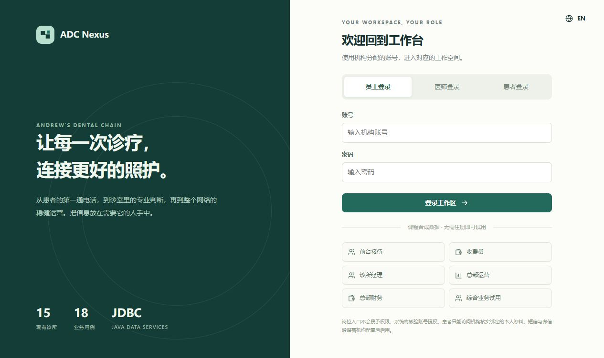

# ADC Nexus · Java JDBC Application

安德鲁牙科连锁运营管理系统。根据已审阅的分析与设计报告实施，采用 Java 21、参数化 JDBC 和同源 Web 工作台；不使用 JPA/Hibernate。当前为 `1.0.0-rc1` 发布候选版，云端部署与最终报告同步尚待完成。

## 入口与文档

| 内容 | 入口 |
|---|---|
| 软件设计规格与 18 项用例映射 | [SDS](docs/SDS.md) |
| 免费发布操作手册 | [Render + Neon](docs/DEPLOYMENT.md) |
| 教师试用路径与边界 | [Review guide](docs/REVIEW_GUIDE.md) |
| 实施差异与报告同步清单 | [Change control](docs/CHANGE_CONTROL.md) |
| 接口合同 | [API](docs/API.md) |
| 分轮迭代与发布门槛 | [Release readiness](docs/RELEASE_READINESS.md) |
| SQLite / PostgreSQL 自动验收证据 | [qa](qa/) |

## 本地运行



安装 Java 21+ 和 Maven 3.9+。在此目录执行：

```powershell
mvn -B -ntp package
$env:DEMO_MODE="true"
$env:PORT="8087"
java -jar target/adc-nexus.jar
```

打开 `http://localhost:8087`。首次启动建立合成数据库；默认使用 SQLite JDBC，文件在被 Git 忽略的 `data/`。无 Maven 的 Windows 环境也可执行 `tools/build.ps1 -Run`，需要 Java、Node 和下载依赖的网络；此脚本用于本地开发，不是云构建步骤。

登录提供员工、医师和患者入口。显式启用 `DEMO_MODE=true` 后，可选择合成岗位试用；这是独立的课程演示身份，并非绕过正式账号权限。关闭该设置即关闭公开试用入口。管理员账号 `owner` 的首次密码由 `ADMIN_PASSWORD` 配置；本地未配置时随机产生，仅写入被忽略的 `data/setup-credentials.txt`。不要上传该文件。

## 业务工作区

前台日程与患者主档、候补安排；医师风险复核、FDI 牙位观察、计划与逐项同意、实际治疗、病历版本签署与完成核验；收费员逐项开单、分次收款、原流水退款；经理资源协调与经营指标；总部资质任职、成本及费用归属、季度核定与扩张情景；管理员授权治理；患者本人查询。

导航、首页及服务端数据范围均按岗位授权区分。管理员不默认获得病历或收退款权；全网管理员角色也不会扩大同一账号的本店业务权限。临床明细和修改受负责牙医约束。

## 结构与验证

- `src/main/java/cn/adcnexus/`：HTTP、授权、应用服务、JDBC 事务。
- `src/main/resources/web/`：原生 HTML/CSS/JavaScript，无外部运行时依赖。
- `src/main/resources/db/`：报告原模型、PostgreSQL 迁移、合成数据和实施增补。
- 原模型 61 表/730 字段/119 外键保持独立基线；实施新增 4 张业务证据表、2 张技术表，实际共 67 表。
- PostgreSQL 使用 HikariCP 有界 JDBC 连接池；写入采用数据库事务互斥与对象版本检查。钱款为整数分，不以浮点数核算。

```powershell
python tools/verify.py
node tools/verify_web.mjs
```

测试在新建、隔离的合成数据库中运行，不向托管数据写入。PostgreSQL 测试只接受 `ADC_ACCEPTANCE_PG_URL` 指向回环地址且库名以 `adc_acceptance_` 开头；详见脚本和 QA 结果。Maven `package` 负责打包，业务集成验收必须另行运行，不能用“打包成功”替代。

## 重要边界

公开环境仅允许课程合成数据，不收集真实患者资料。短信、微信及短信找回密码没有机构凭据，不假装发送成功；密码登录、授权和本人绑定可用。收退款登记经核实的业务凭据，不执行银行或支付划转。病历签署为账号、版本、时间及校验值留痕，不宣称具有第三方法律电子签名认证。

Render 免费实例可能休眠；Neon 免费额度及资源限制以平台当前页面为准。此组合不承诺生产医疗系统的持续运行等级。数据库放在 Neon，不依赖 Render 临时磁盘。详细上线条件、未启用能力及报告修订必须保留，不能把课程演示表述成真实医疗机构正式上线。
