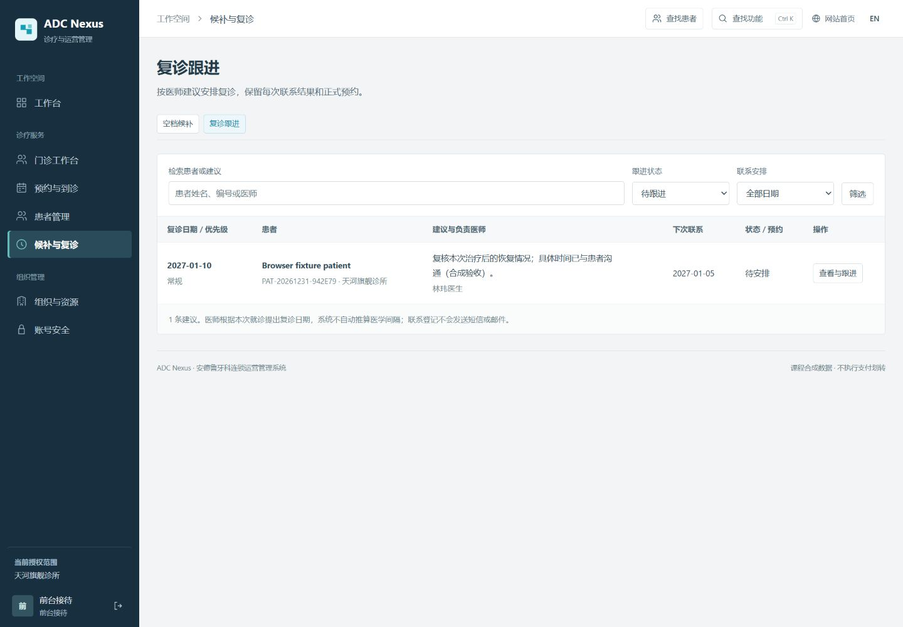
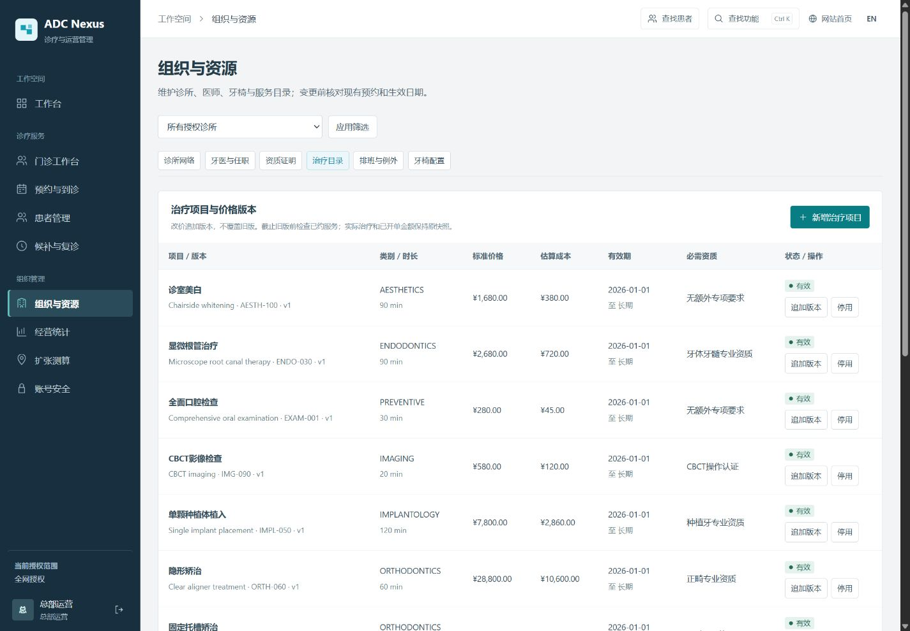
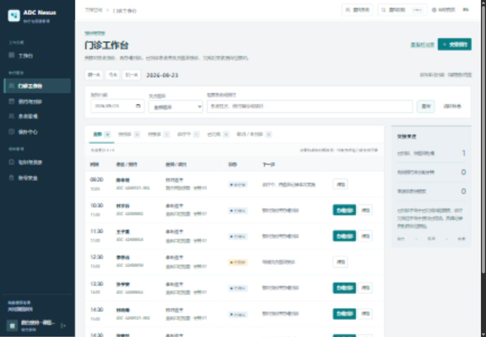
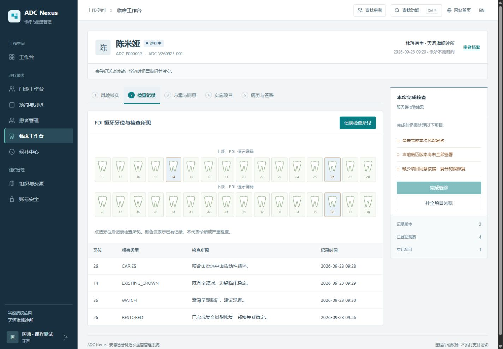

# ADC Nexus · Java JDBC Application

安德鲁牙科连锁运营管理系统。采用 Java 21、参数化 JDBC 和同源 Web 工作台；不使用 JPA/Hibernate。当前 `1.5.0-rc1`：统一账号与分岗位工作区、医师/牙椅时间表、临床分区及签署、逐项结算；新增可维护的诊所/医师/牙椅/营业时间、目录价格版本、预约联系确认和复诊跟进。云端发布、真实消息送达及最终报告同步分别验收，尚不能称为真实医疗生产上线。

## 入口与文档

| 内容 | 入口 |
|---|---|
| 1.5 基础配置、目录与复诊跟进合同 | [Practice upgrade](docs/PRACTICE_UPGRADE_V1_5.md) |
| 老师推荐来源、迁移决定和每项变更 | [Upgrade workbench](upgrade-workbench/2026-10-30/README.md) |
| 发布后逐项同步原报告的索引 | [Report sync index](upgrade-workbench/2026-10-30/REPORT_SYNC_INDEX.md) |
| 2026-10-22 首页版心、图文比例与小屏修订 | [Homepage layout patch](docs/HOME_LAYOUT_FIX_20261022.md) |
| 2026-10-22 桌面 Start / Status / Stop 秒退修复 | [Launcher hotfix](docs/LOCAL_LAUNCHER_FIX_20261022.md) |
| 1.4 真实岗位工作流、界面与调研 | [1.4 implementation](docs/PRACTICE_WORKFLOW_V1_4.md) |
| 1.3 时间表及界面修订 | [1.3 implementation](docs/CLINIC_WORKFLOW_V1_3.md) |
| 首页、工作区精修及桌面启动说明 | [1.2 implementation](docs/HOMEPAGE_AND_WORKSPACE_V1_2.md) |
| 软件设计规格与 18 项用例映射 | [SDS](docs/SDS.md) |
| 统一账号、员工编号及界面增量 | [1.1 specification](docs/AUTH_AND_UI_V1_1.md) |
| 手机与邮箱真实发送开通 | [Channel setup](docs/CHANNEL_SETUP.md) |
| 免费发布操作手册 | [Render + Neon](docs/DEPLOYMENT.md) |
| 教师试用路径与边界 | [Review guide](docs/REVIEW_GUIDE.md) |
| 实施差异与报告同步清单 | [Change control](docs/CHANGE_CONTROL.md) |
| 接口合同 | [API](docs/API.md) |
| 分轮迭代与发布门槛 | [Release readiness](docs/RELEASE_READINESS.md) |
| SQLite / PostgreSQL 自动验收证据 | [qa](qa/) |

## 本地运行





预览图来源见 [截图记录](docs/images/v1-5/PROVENANCE.md)。这些图片不代表已经完成公网发布。





已有本地项目可双击桌面 `ADC Nexus - Start`，`Status` 查看状态，`Stop` 停止；均保留已有数据库。电脑关闭或休眠后，本地链接可能不可访问，需重新启动。快捷方式安装脚本是 `tools/install-shortcuts.ps1`，实际启动脚本是 `tools/local-server.ps1`。

安装 Java 21+ 和 Maven 3.9+。在此目录执行：

```powershell
mvn -B -ntp package
$env:DEMO_MODE="true"
$env:PORT="8087"
java -jar target/adc-nexus.jar
```

打开 `http://localhost:8087`。首次启动建立合成数据库；默认使用 SQLite JDBC，文件在被 Git 忽略的 `data/`。无 Maven 的 Windows 环境也可执行 `tools/build.ps1 -Run`，需要 Java、Node 和下载依赖的网络；此脚本用于本地开发，不是云构建步骤。

统一登录不选择岗位，按服务端授权进入不同界面。注册分患者和内部员工，须双通道验证；员工须匹配机构名册及激活码。缺发送配置时原账号仍可密码登录，注册明确显示待配置。显式 `DEMO_MODE=true` 开放独立课程综合演示，不代表真实员工身份；关闭即关闭公开演示入口。管理员 `owner` 密码由 `ADMIN_PASSWORD` 配置，或首次本地随机写入被忽略的 `data/setup-credentials.txt`，不要上传。

## 业务工作区

前台日程与患者主档、候补安排；医师风险复核、FDI 牙位观察、计划与逐项同意、实际治疗、病历版本签署与完成核验；收费员逐项开单、分次收款、原流水退款；经理资源协调与经营指标；总部资质任职、成本及费用归属、季度核定与扩张情景；管理员授权治理；患者本人查询。

导航、首页及服务端数据范围均按岗位授权区分。管理员不默认获得病历或收退款权；全网管理员角色也不会扩大同一账号的本店业务权限。临床明细和修改受负责牙医约束。

## 结构与验证

- `src/main/java/cn/adcnexus/`：HTTP、授权、应用服务、JDBC 事务。
- `src/main/resources/web/`：原生 HTML/CSS/JavaScript，无外部运行时依赖。
- `src/main/resources/db/`：报告原模型、PostgreSQL 迁移、合成数据和实施增补。
- 原模型 61 表/730 字段/119 外键保持独立基线；当前实施模型 71 表、146 条外键，包含身份、业务证据、技术迁移与复诊跟进。
- PostgreSQL 使用 HikariCP 有界 JDBC 连接池；写入采用数据库事务互斥与对象版本检查。钱款为整数分，不以浮点数核算。

```powershell
$env:ADC_ACCEPTANCE_JAR="true"
python tools/verify.py
python tools/verify_auth.py
node tools/verify_web.mjs
node tools/verify_homepage.mjs
node tools/verify_clinic_ui.mjs
node tools/verify_practice_ui.mjs
```

测试在新建、隔离的合成数据库中运行，不向托管数据写入。PostgreSQL 测试只接受 `ADC_ACCEPTANCE_PG_URL` 指向回环地址且库名以 `adc_acceptance_` 开头；详见脚本和 QA 结果。Maven `package` 负责打包，业务集成验收必须另行运行，不能用“打包成功”替代。

## 重要边界

公开环境仅允许课程合成数据，不收集真实患者资料。手机/邮箱验证、注册和找回逻辑已实现，真实发送须配置并另验收；支持 SMTP、Brevo HTTPS 邮件与 Twilio HTTPS 短信，国内短信不作送达保证。微信仍未启用。收退款不执行支付划转，病历签署不宣称第三方法律电子签名认证。

Render 免费实例可能休眠；Neon 免费额度及资源限制以平台当前页面为准。此组合不承诺生产医疗系统的持续运行等级。数据库放在 Neon，不依赖 Render 临时磁盘。详细上线条件、未启用能力及报告修订必须保留，不能把课程演示表述成真实医疗机构正式上线。
